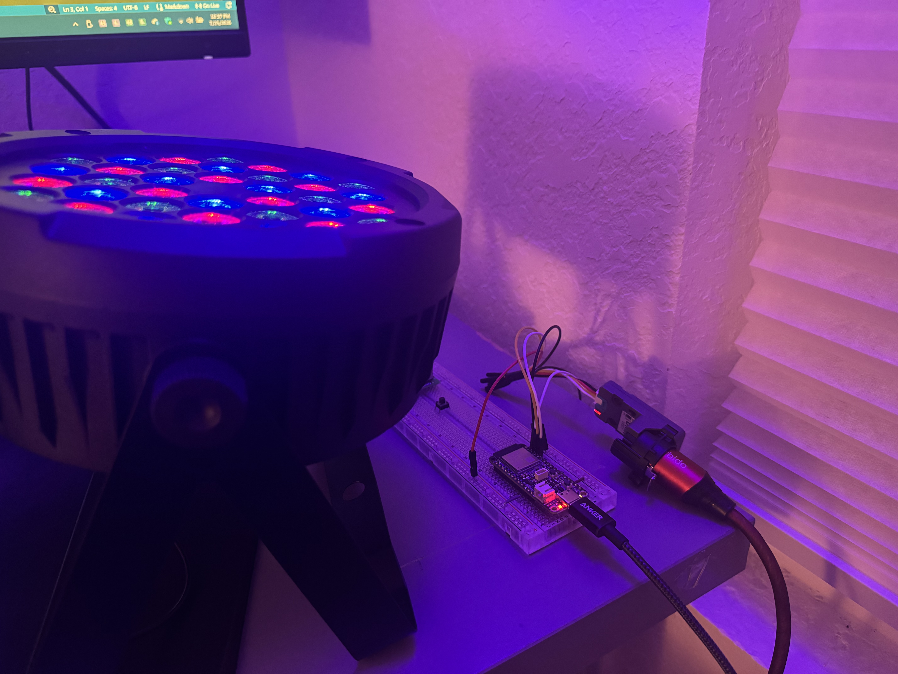
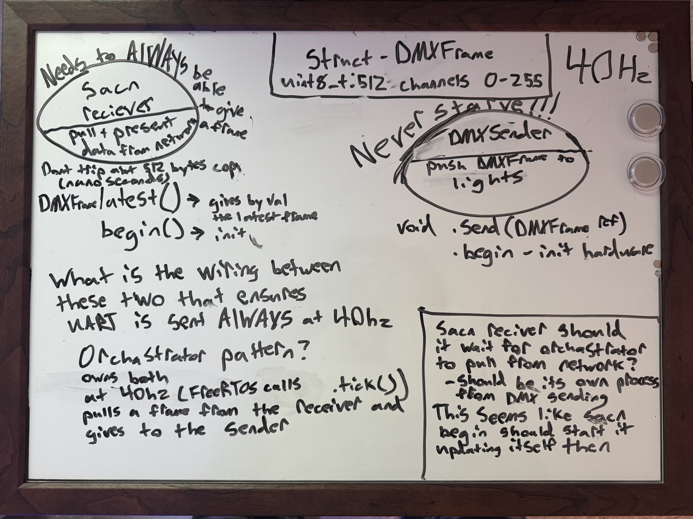
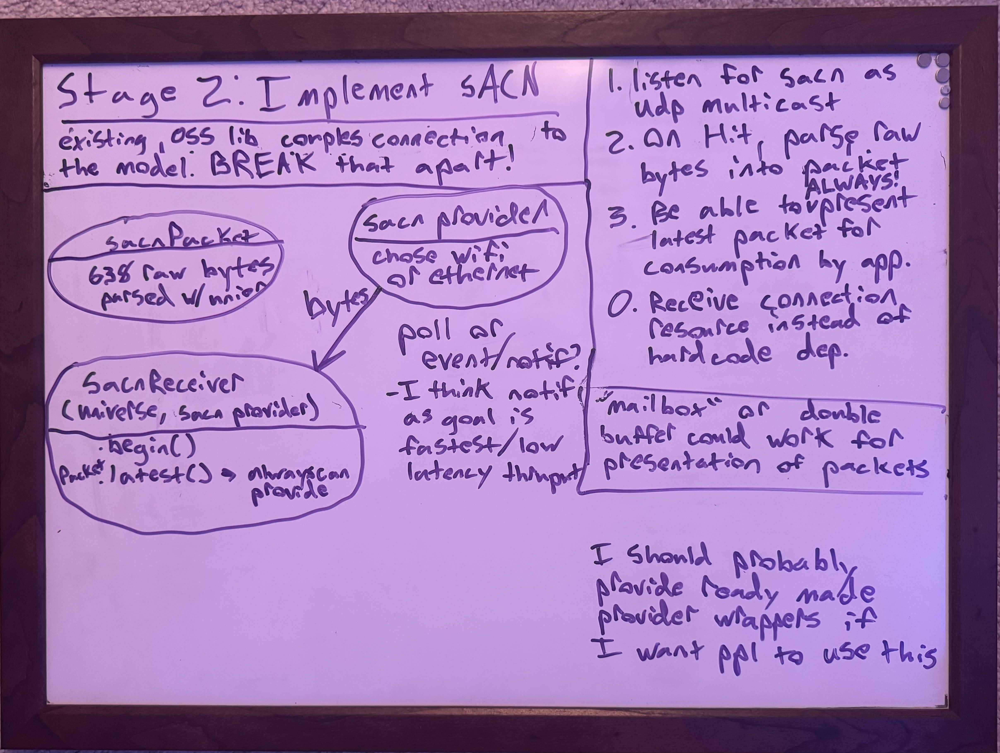

# Feather-dmx-node

ESP32-S3 firmware that takes lighting data in over the network (sACN / E1.31) and blasts it
back out as DMX512 to real fixtures. Basically a simple sACN-to-DMX node.

Right now it works end to end using (someweisguy/esp_dmx) and (forkineye/ESPAsyncE131): a lighting desk (QLC+ in my case) sends a
universe, the feather picks it up over wifi, and pushes those 512 channels over UART to
the lights.

<p align="center">
  
  <br><em>the node as of this readme commit</em>
</p>

In progress: implement sACN myself and remove usage of forkineye's ESPAsyncE131 library. I want my library to support ethernet and wifi, and hopefully be a little more general purpose sACN for the ESP32 that what I've seen so far.

Long term stretch goal is a node with full runtime config and such, remove the hard coding and make it something a little closer to what is available commercially, wifi or ethernet would be great for opening up use cases in less critical environments than professional theatre

## How it's built

- Adafruit Feather ESP32-S3
- M5 [uart] DMX Unit (handles the nasty electrical stuff with DMX512 aka RS-485)

The idea was to keep the hardware/library specific stuff behind interfaces so I can swap the
guts out without touching the logic. This will also support getting unit tests in place soon.

It's currently using the Arduino family of functions just out of convenience to start the project, however I find myself interested in FreeRTOS and it is already using a decent amount of that library. Soon this project should be made native to ESP_IDF library.

Some of the design/planning as it came together to this current state:

<p align="center">
  
  
</p>

## Building

PlatformIO with Arduino framework, targeting an Adafruit Feather ESP32-S3.

You will need a `src/secrets/secrets.hpp` (its gitignored) that looks like:

```cpp
namespace secrets
{
    const char ssid[] = "your-wifi";
    const char passphrase[] = "your-password";
}
```

Then build/flash with PlatformIO like normal.
Should be off to the races

---